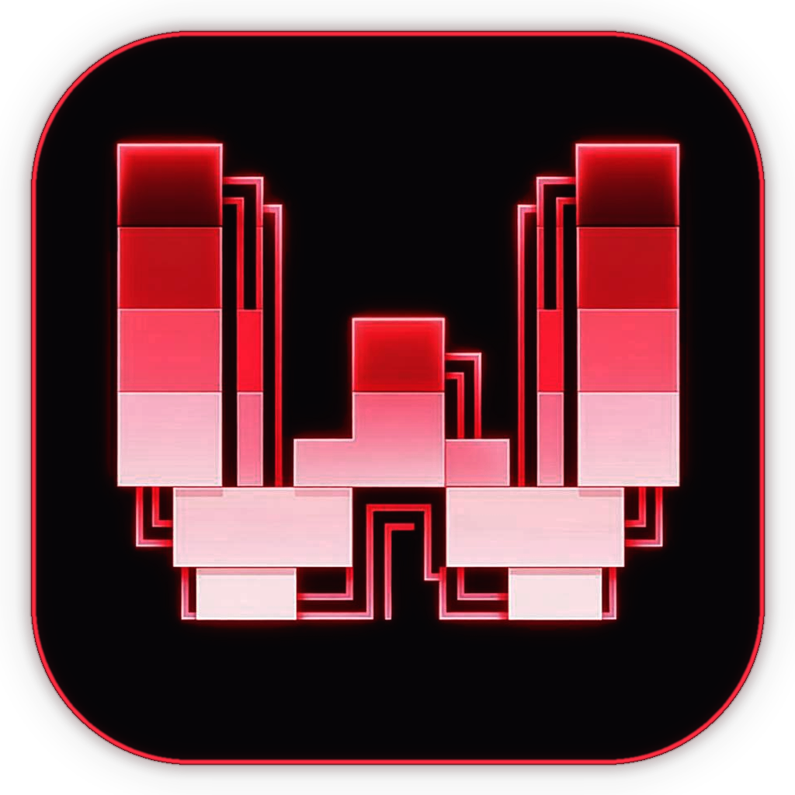

<div align="center">



# WHIS BEATS

### The Ultimate Native Music Streaming & Local Playback Client, Built with Rust and GPUI

Stream from your favorite services and play local files — all in one blazingly fast **native** desktop app.

[](./COPYING)
[](https://github.com/NamanGaonkar)
[](https://github.com/NamanGaonkar/WHIS-BEAT/releases)

</div>

<div align="center">
    <table>
      <tr>
        <td colspan="2">
          
        </td>
      </tr>
      <tr>
        <td width="50%">
          
        </td>
        <td width="50%">
          
        </td>
      </tr>
    </table>
</div>

<div align="center">
    <sub>
      Adaptive themes are optional. Everything is customizable.
    </sub>
</div>

> [!IMPORTANT]
> **WHIS BEATS is not a piracy tool.**
>
> WHIS BEATS is not a platform for obtaining or sharing copyrighted material. We will not implement any functions that can be used to export decrypted streams, DRM licenses, content keys, or to convert protected streams into media files.
>
> WHIS BEATS is not designed to circumvent subscriptions or other restrictions put in place by music streaming platforms. If the service demands that you have a valid subscription in order to play back their tracks, so will WHIS BEATS.
>
> Features aimed at ripping, downloading, distributing, or gaining access to protected streaming content are out of scope for the project.

## Features

- **Apple Music, Spotify, YouTube Music, Deezer, Tidal, Subsonic/Navidrome** and local audio library playback
- Gapless playback, audio normalization, shuffle, sleep timer
- Synced/karaoke lyrics, background vocals, and romanization
- Scrobbling with LastFM, ListenBrainz, LibreFM, and Maloja
- Themes, fonts, icons, transparency, blur, and window styling
- Discord Rich Presence, native file opening
- Windows, macOS, Linux, and FreeBSD support
- Powerful CLI control integration

## Installation & Releases

Download the latest version from our [Releases page](https://github.com/NamanGaonkar/WHIS-BEAT/releases).

### Windows

Download the latest release executable or installer from [Releases](https://github.com/NamanGaonkar/WHIS-BEAT/releases).

### Building From Source

Prerequisites:
- [Rust toolchain](https://rustup.rs/) (stable, 1.80+)
- C/C++ build tools (MSVC on Windows, Xcode on macOS, build-essential on Linux)

```sh
# Clone the repository
git clone https://github.com/NamanGaonkar/WHIS-BEAT.git
cd WHIS-BEAT

# Build the release binary
cargo build --release

# Run WHIS BEATS
cargo run --release
```

## CLI Usage

WHIS BEATS includes a built-in CLI to control the running app from your terminal or scripts:

```sh
# Control playback
whis-beats toggle
whis-beats next
whis-beats prev

# Current song info
whis-beats current

# Search and queue
whis-beats search "song name"
whis-beats add <file|link>
```

## Translations

<!-- i18n:start -->

| Language | Translated | Coverage |
| --- | --- | --- |
| English (`en-US`) | 1123/1123 | 100% |
| Deutsch (`de`) | 1123/1123 | 100% |
| Español (`es`) | 1123/1123 | 100% |
| Français (`fr`) | 1123/1123 | 100% |
| Italiano (`it`) | 1123/1123 | 100% |
| Bahasa Indonesia (`id`) | 1123/1123 | 100% |
| 日本語 (`ja`) | 1123/1123 | 100% |
| Русский (`ru`) | 1123/1123 | 100% |
| Українська (`uk`) | 1123/1123 | 100% |
| Polski (`pl`) | 1123/1123 | 100% |
| Čeština (`cs`) | 1123/1123 | 100% |
| Português (Brasil) (`pt-BR`) | 1123/1123 | 100% |
| 简体中文 (`zh-CN`) | 1123/1123 | 100% |
| Türkçe (`tr`) | 1123/1123 | 100% |
| Shqip (`sq`) | 1123/1123 | 100% |

<!-- i18n:end -->

## Maintainer & Author

- **Lead Maintainer:** [Naman Gaonkar](https://github.com/NamanGaonkar) ([Portfolio](https://naman-gaonkar.vercel.app/))

<a href="https://github.com/NamanGaonkar">
  
</a>

## Credits

WHIS BEATS is built with the help of incredible open-source projects, including:

- [Zed](https://github.com/zed-industries/zed) — provides `gpui`, the native GPU-accelerated Rust rendering framework.
- [librespot](https://github.com/librespot-org/librespot) — Spotify playback and library integration.
- [yt-dlp](https://github.com/yt-dlp/yt-dlp) — YouTube integration.

## License

Copyright (C) 2026 WHIS BEATS Contributors & Naman Gaonkar.

WHIS BEATS is free software, released under the [GNU General Public License version 3 or later](COPYING).

WHIS BEATS is an unofficial client and is not affiliated with, endorsed by, or sponsored by Spotify AB or Apple Inc.
